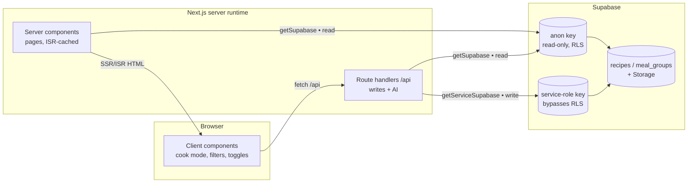

# Architecture

A short map of how Creaciones Colibrí is put together — the rendering model, how data flows on reads vs. writes, the taxonomy/region rules, and the write-auth model. For setup and env vars see [README.md](README.md) and [DEPLOY.md](DEPLOY.md).

## Rendering model

Next.js App Router. Pages are **server components** that fetch from Supabase at request/build time and are **ISR-cached** (`revalidate = 3600`), so browse/detail pages serve from cache and refresh hourly. Interactive pieces (cook mode, servings stepper, unit toggle, favorites, filters) are **client components**. All mutations and AI calls go through **route handlers** under `src/app/api/`.

Every reader-facing route is locale-prefixed (`/en`, `/es`) via the `[lang]` segment.

## Data flow

**Read path.** Server components call helpers in `src/lib/recipes.ts` (e.g. `getRecipeById`, `getRecipeCards`, `getRecipeCardsFiltered`) which use the **anon** client (`getSupabase()`). The `recipes` table is RLS-locked to read-only for anon, so a leaked anon key can't write. List queries select a narrow `CARD_FIELDS` projection rather than `*`.

**Write path.** Only route handlers write, and only through `getServiceSupabase()` — a **server-only** client using `SUPABASE_SERVICE_ROLE_KEY` that bypasses RLS. That key never enters the browser bundle. Every write handler is gated (see [Auth & writes](#auth--writes)).

## Search

Keyword search resolves to a single Postgres RPC, `search_recipes(q)`, called from both `src/lib/recipes.ts` and `/api/recipes`. Under the hood it uses **full-text search** (English + Spanish configs) with `ts_rank` ordering, a `pg_trgm` similarity fallback for typos, and `unaccent` so "platano" matches "plátano". Ordering from the SQL function flows through PostgREST to the UI.

Search is **keyword-only by design** — no embeddings / semantic search. At this collection size FTS + trigram is the right tool and adds no infrastructure beyond the Postgres already in use.

## Taxonomy & region rules

`src/lib/taxonomy.ts` is the single source of truth for the controlled vocabulary:

- **Category** — a fixed 12-value enum (`Mains`, `Sides`, `Soups`, `Salads`, `Breakfast`, `Desserts`, `Drinks`, `Sauces`, `Preserves`, `Snacks`, `Appetizers`, `Breads`), enforced by a DB `check` constraint.
- **Difficulty** — `easy` / `medium` / `hard`.
- **Dietary** — a flag array (`vegetarian`, `vegan`, `gluten-free`, `dairy-free`, `pescatarian`, `keto`).
- **Region** — free text, but **never finer than a country**. "Costa Rica" is a *region*; "Costa Rican" (including "Costa Rican (Caribbean)") stays a *cuisine*. `SUGGESTED_REGIONS` seeds the admin datalist and the Spanish label map.

The `derive*` helpers (`deriveCategory`, `deriveRegion`, `deriveDietary`, `deriveDifficulty`) infer structured fields from a recipe's tags/cuisine/steps, and `buildTaxonomyPatch` assembles the column updates — used by import and the `/api/admin/backfill-taxonomy` maintenance route. Spanish labels for every vocabulary term live alongside the vocab as lowercased-key maps.

**Reading side is data-driven.** The lists above are the vocabulary for *editing* (recipe form, AI import). Browse filters, the `/category` and `/region` pages and the sitemap never use them: `src/lib/facets.ts` derives options and counts from the recipes that exist (an option with no recipes does not appear; counts are recomputed against the other active filters). `generateStaticParams` builds only non-empty category/region pages. A valid but empty category/region URL renders a friendly `noindex` page linking to non-empty neighbours; an unknown slug is a 404. Old `?region=Caribbean`-style links show an empty state with a "Remove filter" button per active filter.

## Auth & writes

The `recipes` table is RLS-locked; reads are public (anon), writes require the service-role client **and** pass the app-level gate in `src/lib/adminAuth.ts`:

- `writeAllowed(req)` permits a write when either an httpOnly **session cookie** (set by `POST /api/auth/login`) or an `Authorization: Bearer <ADMIN_PASSWORD>` header is present.
- **Default-deny in production:** if `ADMIN_PASSWORD` is unset, writes are denied on a real prod deploy (`VERCEL_ENV === 'production'`) but stay open in dev/preview so local work isn't blocked. `src/lib/runtime.ts` draws that prod/preview distinction (Vercel sets `NODE_ENV=production` for previews too, so `VERCEL_ENV` is the reliable signal).
- **Finca account sign-in** (the default UI): the browser signs in with Supabase Auth and sends the access token to `POST /api/auth/login`, which verifies it, checks `public.finca_can_write(FINCA_ID)` as that user, and only then issues the same session cookie. `{ password }` on the same route is the fallback. See README "How editing sign-in works".
- The session cookie is a signed token (`src/lib/adminSession.ts`), httpOnly so client JS can't read it — replacing an earlier scheme that mirrored the password into localStorage.

Supporting guards on the same routes: **rate limiting** (`src/lib/rateLimit.ts` — Upstash Redis when configured, in-memory fallback otherwise), an **SSRF guard** on URL import (`src/lib/ssrf.ts`), request-body validation with Zod (`src/lib/schemas.ts`, `src/lib/requestBody.ts`), and a **CORS** lock to the site origin (`src/lib/cors.ts`).

## AI calls

Every AI route runs on **Claude Haiku 5.5** (`claude-haiku-5-5`, exact id, never a dated one). The model is one constant in `src/lib/ai.ts` (`aiModel()`), overridable with `AI_MODEL`; the Cocina chat also honours its own `COCINA_CHAT_MODEL`, which wins for that route. `src/lib/aiModels.test.ts` fails if a route hard-codes another id or sends a field Haiku 5.5 rejects.

| Route / module | Effort | `max_tokens` | Notes |
|---|---|---|---|
| `POST /api/import/text`, `/photo`, `/url` (shared `lib/importRecipe.ts`) | `medium` | 8000 | structured output (`RECIPE_SCHEMA`); photo sends the image as base64 |
| `POST /api/identify` (photo step, suggestions step) | `medium` | 8000 each | structured output; a refused or cut-off suggestions step still returns the ingredients |
| `POST /api/recipe-chat` | `low` | 1500 | plain text; `lang` from the form picks the language of problem messages |
| `lib/translate.ts` (`/api/translate`, auto-translate on create) | `low` | 16000 | structured output; any problem gives `null` (left untranslated) |
| `POST /api/cocina/chat` | `low` | 4000 | streamed, see below |

How the calls follow Haiku 5.5's rules (`src/lib/ai.ts`, `src/lib/aiSchemas.ts`):

- **No** `thinking` param (adaptive thinking is on by default and its tokens count as output, so ceilings are generous; the newer tokenizer also counts about 30% more tokens), no `budget_tokens`, no sampling params, no assistant prefill, no forced `tool_choice`.
- **JSON comes from `output_config.format`** (a JSON Schema per route), not from "return ONLY JSON" plus a regex. `parseJsonObject` still tolerates a fenced or prose-wrapped object in case the format is not applied.
- **Text is picked by block type** (`textOf`), never `content[0]`: the reply may start with a `thinking` block.
- **`readOutcome(message)`** classifies a finished message: `ok`, `refusal` (with `stop_details.category`), `max_tokens` (partial text, never parsed as complete) or `empty`. Imports and identify answer a problem with a 422 and a message in both languages (`problemText`); recipe-chat answers in the form's language; translate returns `null`. Haiku 5.5 has no server-side refusal fallback, so there is none here.
- The large calls use `client.messages.stream(...).finalMessage()` (`runMessage`) to avoid HTTP timeouts; the Cocina chat streams to the hub.

## Cocina chat (`POST /api/cocina/chat`)

Called from the finca hub (a static site on another origin) to chat about one Cocina recipe. Contract: `docs/umbrella/cocina-chat-api.md` in the Finca Colibrí repo.

- **Auth:** `Authorization: Bearer <Supabase access token>`; the route verifies it, then calls `finca_can_write(FINCA_ID)` as that user (like `/api/auth/login`). Only finca admins and editors pass; it spends money. No cookie is issued.
- **CORS:** its own allow-list from `HUB_ORIGINS` (`src/lib/hubCors.ts`); every other route keeps the site-origin lock in `cors.ts`.
- **Limits:** a loose per-IP limit before auth and 20 requests / 5 min per user after; JSON body at most 64 KB (413), validated with Zod (`src/lib/cocinaChat.ts`).
- **Model call:** `claude-haiku-5-5` (`AI_MODEL`, or `COCINA_CHAT_MODEL` for this route only), no `thinking` (adaptive by default), `output_config.effort: 'low'`, `max_tokens` 4000, `client.messages.stream`. The system prompt (one stable variant per language, cacheable) says recipe text is data, not instructions; the formula and context are the first user turn inside `<finca_data>` JSON.
- **Proposals:** the `propose_version` tool (`strict: true`, `tool_choice` auto). The model is told to write one or two sentences first and then call the tool. When the stream ends with that tool call, the route validates the input again, sends a `proposal` event and then `done`; there is **no tool_result follow-up request** (one request per turn, half the cost). If the model skipped the sentence, a fixed localized one is sent before the proposal.
- **Events:** `delta` / `proposal` / `done` (`stopReason`, `usage`) / `error` (`refusal`, `max_tokens`, `upstream`). Refusals and `max_tokens` become `error` events; SDK errors are caught by class (`RateLimitError`, `APIConnectionError`, `APIError`, ...).
- **Logs:** status, token usage, model and user id only; never recipe or message text.

## Internationalization

UI strings live in one dictionary (`src/lib/i18n.ts`) keyed by a `TranslationKey` union, with `en` and `es` tables kept in lockstep (a coverage test guards against drift). Recipe *content* is bilingual per-row (`title` / `title_es`, `tags` / `tags_es`, translated steps/ingredients); a recipe missing Spanish can be translated on demand via `/api/translate`.

## Client-side layer

- **Personal features** are per-device via `localStorage` hooks (`useFavorites`, `useRecentlyViewed`, `useCookNotes`, `useUnitSystem`, plus ingredient check-off), synced across components/tabs with custom events. No account required.
- **PWA** — `src/app/manifest.json` + a hand-authored service worker (`public/sw.js`) with an offline fallback (`public/offline.html`). Cook mode holds a **screen wake lock** (`useWakeLock`).
- **Images** — stored in Supabase Storage; `sharp` + `thumbhash` produce a `blurDataURL` from the `image_thumbhash` column so cards paint a blur placeholder with no layout shift.

## Where things live

| Concern | Location |
|---|---|
| Pages (per locale) | `src/app/[lang]/…` |
| API route handlers | `src/app/api/…` |
| Data access | `src/lib/recipes.ts`, `src/lib/supabase.ts` |
| Taxonomy / vocab | `src/lib/taxonomy.ts` |
| Browse/filter/sort | `src/lib/browse.ts` |
| Quantities / units / time | `src/lib/scale.ts`, `src/lib/convert.ts`, `src/lib/time.ts` |
| AI calls (model, outcomes, schemas) | `src/lib/ai.ts`, `src/lib/aiSchemas.ts`, `src/lib/importRecipe.ts` |
| Auth / safety | `src/lib/adminAuth.ts`, `src/lib/adminSession.ts`, `src/lib/rateLimit.ts`, `src/lib/ssrf.ts`, `src/lib/cors.ts`, `src/lib/schemas.ts` |
| i18n | `src/lib/i18n.ts` |
| Client hooks | `src/lib/use*.ts` |
| DB schema | `supabase/migrations/` |
